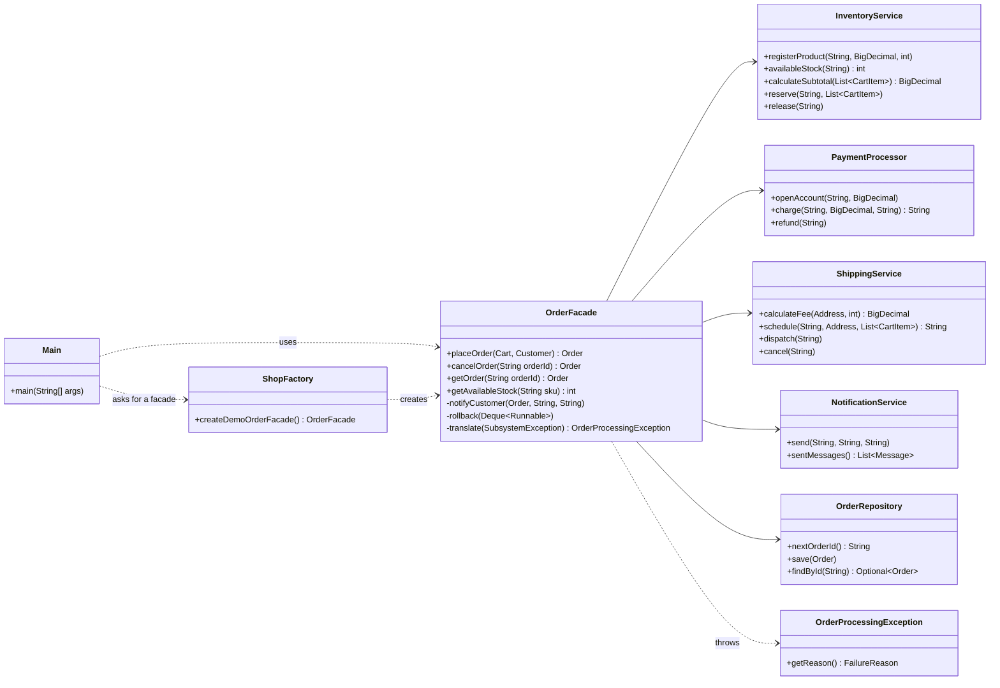

# Order Processing Facade (Java)

Implementation of the **Facade** structural design pattern for the course
*Software Design Patterns*, Assignment #4 (Option B — Online Order Processing Facade).

Placing an online order needs five collaborating classes: check and reserve stock, take
the payment, book the delivery, store the order and e-mail the customer. If one step fails,
the earlier steps must be undone. The `OrderFacade` hides all of this behind two simple calls:

```java
Order order = shop.placeOrder(cart, customer);
shop.cancelOrder(order.getId());
```

## Requirements

* JDK 17 or newer (developed in IntelliJ IDEA, but any IDE or the command line works)
* No external libraries

## How to run

| What | Linux / macOS | Windows |
| --- | --- | --- |
| Demo (client with 7 scenarios) | `./run.sh` | `run.bat` |
| Tests (15 checks, no JUnit needed) | `./test.sh` | `test.bat` |

In IntelliJ IDEA: open the folder, mark `src/main/java` and `src/test/java` as source roots,
run `client.Main` or `OrderFacadeTests`.

## Project structure

```
src/main/java/com/example/orderfacade
├── model/        Address, Customer, Cart, CartItem, Order, OrderStatus   (plain data)
├── subsystem/    InventoryService, PaymentProcessor, ShippingService,
│                 NotificationService, OrderRepository + their exceptions (the complex part)
├── facade/       OrderFacade, OrderProcessingException, FailureReason     (the Facade)
├── config/       ShopFactory                                              (wires the subsystem)
└── client/       Main                                                     (uses only the Facade)
src/test/java/com/example/orderfacade/OrderFacadeTests.java
```

## Pattern roles

| Role | Class(es) | Notes |
| --- | --- | --- |
| Complex subsystem | `InventoryService`, `PaymentProcessor`, `ShippingService`, `NotificationService`, `OrderRepository` | Each has its own real logic: all-or-nothing stock reservation, balances with charge/refund, shipping fees and shipment states, e-mail outbox, order storage |
| Facade | `OrderFacade` | `placeOrder`, `cancelOrder`, `getOrder`, `getAvailableStock` |
| Client | `client.Main` | Imports no subsystem class |

### Class diagram



## How `placeOrder` works

1. Validate the request.
2. Calculate the total: product prices (`InventoryService`) + delivery fee (`ShippingService`).
3. Reserve stock → charge the customer → schedule the shipment.
   After each step an "undo" action is remembered (release stock, refund payment).
4. If a step fails, the undo actions run newest-first, and the failure is reported to the
   client as an `OrderProcessingException` with a `FailureReason` — the client never sees
   subsystem exception types.
5. On success the order is stored and a confirmation e-mail is sent. A failing e-mail does
   **not** cancel the order; it is recorded as a note on the order.

`cancelOrder` cancels the shipment first (this can fail if the parcel was already dispatched,
in which case nothing has changed yet), then refunds the payment and returns the stock.

## Properties required by the pattern

* The subsystem classes know nothing about `OrderFacade` (no back-references).
* They can still be used directly — see `subsystemClassesWorkWithoutTheFacade` in the tests.
* The client only talks to the facade; the subsystem is created in one place, `ShopFactory`.

## Demo output (`./run.sh`)

```
--- 1. Successful order ---
Placed: Order{ORD-0001, PLACED, total=1066.99, tracking=TRK-0001}
Laptops left in stock: 4
--- 2. Not enough stock ---
Rejected [OUT_OF_STOCK]: Not enough stock for KEYBOARD: requested 3, available 2
...
--- 6. Cancel the first order ---
Cancelled: Order{ORD-0001, CANCELLED, total=1066.99, tracking=TRK-0001}
Laptops left in stock: 5
```
